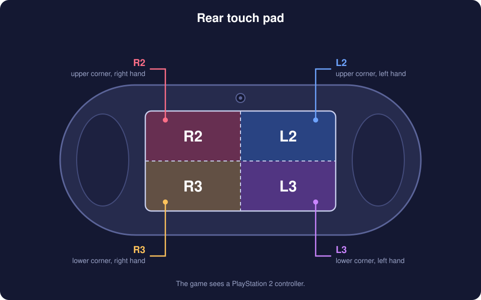

# Need for Speed Underground 2 for the PS Vita

A fan project that enables you to play your own PC copy of Need For Speed Underground 2 (Version 1.2) on your PS VITA. This is not the game files for Need For Speed Underground 2. You must provide your own legally obtained copy of the game. This project provides a compatibility layer along with performance optimisations to allow the PC version of the game to run on a PS VITA system.

This is not a decompilation or rewrite of the game. The game's own code is translated to C++ ahead of time from your copy of SPEED2.EXE, and the gameplay itself (physics, AI, career, saves) is left as it is.

Changes fall into two groups. Compatibility changes replace what the Vita does not have: Windows, Direct3D 9, mouse and keyboard etc. Performance changes make the game run faster on the Vita's hardware, and some of them deliberately change how things are drawn, for example simpler scenery models at a distance. Anything that visibly changes the picture is a setting that can be turned on/off in config.

It is very possible that some of these changes have brought about unexpected bugs/crashes that do not exist in the PC version, and this is something that will constantly be addressed with updates.

[Install](#install) · [Controls](#controls) · [Settings](#settings) · [Online](#online-and-lan-play) · [Report Bug](../../issues)

> **Playtest.** The game is playable in all aspects. The entire career mode is working, and the framerate is good in most scenes.
> Expect rough edges; [Known issues](#known-issues--caveats) lists the ones we know.

## What this fork adds

This fork builds on [danos-x5/NFSUG2_VITA](https://github.com/danos-x5/NFSUG2_VITA) (v0.8.5) and adds:

- **Online play on the NFSU2 Revived server** ([nfsu2.xyz](https://nfsu2.xyz)): the game's Online and LAN menus
  reach the players of the browser version, and `online_server=` in the settings file picks a community server for
  the `direct` mode. See [Online and LAN play](#online-and-lan-play).
- **Free roam with other players**, NFSU2 Revived's free-roam mod built in: names and flags over players' cars,
  **quick chat** (hold D-pad Down, then a phrase button), crews, and adding friends nose to nose or by name. See
  [Free roam with other players](#free-roam-with-other-players).
- **Vita Settings**, an icon in the game's own menus with the browser version's settings, made of the game's own
  option screens. See [Vita Settings](#vita-settings).
- **Crash and freeze reports** in `crashes/`, and the last run's log kept. See [Crash reports](#crash-reports).
- **Quality of life:** stick dead zone and response, digital steering, right stick chase camera, fast travel from
  the World Map and skipping the intro movies. See [Quality of life options](#quality-of-life-options).
- Faster loading of other players' cars in free roam (car builds spread over frames, the parts database indexed),
  and timing lines in the free roam log for the frames that are still slow.

## Requirements

- Need for Speed Underground 2 for PC, **version 1.2**, installed (your own copy). The whole game folder is needed,
  about 1.7 GB, or about 2 GB with the converted movies.
- The port has only been tested with one version 1.2 `SPEED2.EXE`, the one with SHA-256
  `f9dd86c054878ce6276beb07c1fd61874f7a1e4bf1f241b084c65b73e24168a7`. Nothing checks this on the Vita, and the build
  only warns about another executable, but another one may not work. See [Mods](#mods).
- Only the **US release** of version 1.2 has been tested. The EU release will be tested soon.
- PS Vita with HENkaku / Ensō and [VitaShell](https://github.com/TheOfficialFloW/VitaShell)
- About 2.5 GB free on the memory card
- Only if you build the VPK yourself instead of downloading it: a Mac with Apple silicon or an x86-64 Windows PC
  (see [Build](#build)). These are the two kinds of computer the build is tested on.
- [CapUnlocker](https://github.com/GrapheneCt/CapUnlocker) is recommended: it lets the port use the Vita's fourth
  CPU core.
- [PSVshell](https://github.com/Electry/PSVshell) is optional but recommended in this playtest state: overclocking
  the CPU to 500 MHz with it increases performance.

The port sets the Vita's CPU and GPU clocks itself, so the game runs without an overclocking plugin.

## Install

1. Download `NFSU2VITA.vpk` from the [Releases](../../releases) page. You can also build it yourself from your game
   folder (see [Build](#build)).
2. Copy `NFSU2VITA.vpk` to the Vita and install it with VitaShell.
3. (Recommended) Convert the movies in your game folder (see [Movies](#movies)). Without this step the movies will be very
   slow.
4. On your computer, open the game folder (the one with `SPEED2.EXE`) and copy **everything inside it**, every file
   and folder including `MOVIES`, to `ux0:data/NeedForSpeedUnderground2/` (VitaShell's FTP or USB mode works).
   `SPEED2.EXE` must end up at `ux0:data/NeedForSpeedUnderground2/SPEED2.EXE`, not in a subfolder.
5. Start the game from the home screen.

If the game closes right away, `ux0:data/NeedForSpeedUnderground2/NeedForSpeedUnderground2.log` says what is missing.

Your career is saved in `ux0:data/NeedForSpeedUnderground2/save/`. Copy that folder to back it up.

### Icon and LiveArea images

The downloadable VPK has the game's logo on its icon and LiveArea start button. The images in this repository are
plain ones with the game's name as text; a script makes the logo ones from your own game files. It needs only
[Python 3](https://www.python.org/downloads/) and a copy of this repository.

If you build the VPK yourself, `tools/build.py` makes the logo images from your game folder as part of the build.
To put them on a VPK that has plain ones, without building again:

```sh
python3 -I tools/vita/livearea_art.py "<game folder>" --vpk NFSU2VITA.vpk
```

To use your own pictures instead, put `icon0.png` (128x128), `bg.png` (840x500, the LiveArea background) and
`startup.png` (280x158, the start button) in a folder. Each must be an 8-bit palette PNG, 256 colours or fewer,
which [pngquant](https://pngquant.org) makes from an ordinary PNG; the script says so if one is not. Then:

```sh
python3 -I tools/vita/livearea_art.py --images "<your folder>" --vpk NFSU2VITA.vpk
```

### PC save files

Save files from the PC game work. On the PC each profile is a folder named after the profile, in
`%LocalAppData%\NFS Underground 2\`. Copy that folder, with the file inside it, to

```
ux0:data/NeedForSpeedUnderground2/save/NFS Underground 2/<profile name>/
```

so a profile called `Player` ends up as `ux0:data/NeedForSpeedUnderground2/save/NFS Underground 2/Player/Player`. Then load it
from the game's profile screen. The button settings saved in a PC profile come with it; change them in the game's
Controls screen if they do not suit the Vita.

### Movies

The game's movies are the `.vp6` files in its `MOVIES` folder, and the port needs them there. On their own they
are decoded in software, and the picture will be very slow on the Vita while the sound plays normally. With an
H.264 copy of each movie beside the original, the Vita's own video decoder draws the picture and the movies play
smoothly. To make the copies, with [ffmpeg](https://ffmpeg.org) installed, run this once on the PC:

```sh
python3 tools/vita/movies_convert.py "<game folder>/MOVIES"
```

It writes one `.mp4` next to each `.vp6` (29 files, about 310 MB) and changes nothing else. Then copy the game
folder to the Vita as described above, so that `MOVIES` holds both. If you already copied the game, copy the
`MOVIES` folder again.

The `.mp4` files hold the picture and the sound. Keep the `.vp6` files as well: the port needs both. Movies converted
before v0.8.4 have no sound; convert them again.

## Controls

All controls are configurable in the game's Options menu. The Vita appears to the game as a PlayStation 2
controller (Cross is shown as Button 3), and the tables below are the defaults.



### Menus

| Button | Action |
|--------|--------|
| D-pad, left stick | Move |
| Cross | Select |
| Circle | Back |
| Start | Start, skip movie |
| Select + Up | Vita Settings |

### Driving

| Button | Action |
|--------|--------|
| R | Accelerate |
| L | Brake / reverse |
| Left stick | Steer |
| Cross | Handbrake |
| Circle | Nitrous |
| Triangle / Square | Change camera / look back |
| Right stick | Turn the chase camera round the car (`camera_stick`); with the hood and bumper cameras, down looks back |
| Rear touch corners | Not bound; set them in Options > Controls |
| Select | Reset car to the road |
| Start | Pause |

### Free roam

| Button | Action |
|--------|--------|
| D-pad up | Enter a race or shop |
| D-pad right | Read SMS |
| D-pad down | Career statistics |
| D-pad left | World map (with `fast_travel` on, answer No to the GPS question to go to the chosen place) |
| Hold D-pad Down + Up, Left, Right, Cross, Circle or Square | Online free roam: quick chat (see [Quick chat](#quick-chat)) |
| Hold D-pad Down + Triangle | Online free roam: ask the player nose to nose with you to be friends |

A short press of D-pad Down still opens the career statistics; holding it for quick chat does not.

Text fields, such as a profile name, open the Vita keyboard. To quit, use the PS button.

## Settings

### Vita Settings

**Vita Settings**, the main menu icon where Online was (Online is not offered), opens the game's own Options screens
with the settings of the browser version's Settings page that the Vita has, in the same groups: Multiplayer, Free
Roam, Display, Sound, Controller and Game, with the start-up screen's player settings (Performance), Worlds,
Friends and crews, and Mods (NFSU2 Revived, free roam and EU Car Content, each switched on or off). It is also the last icon in the game's Options, and Select + Up opens it
from any front-end menu (not in a race). Pick a group, then change a setting with left and right as in the game's options; Cross on a text
setting, such as a name or the passphrase, opens the Vita keyboard. Each change is saved at once to the same files as
a hand edit and as the start-up screen's: `NeedForSpeedUnderground2.cfg` and free roam's `scripts/NFSU2FreeRoam.ini`.
`log_info` and the garage stick settings apply at once; the others apply when the game starts again, and the game says
so the first time one changes. The last icon, **Save and Restart**, restarts the game. The passphrase is never shown or
logged once typed. `options_menu=off` leaves the icon out.

### Start-up screen

The VPK holds two programs: `eboot.bin`, a small launcher with the start-up screen and settings manager, and
`game.bin`, the game. The launcher only edits the settings files and then starts the game as a new program; the game
reads the files and plays the same way with or without it. `game.bin` copied over `eboot.bin` runs the game alone.

Each time the game starts it first shows a short screen: press START to open the settings manager, or any other
button to start the game at once; after 3 seconds it starts by itself. The sticks and touch pads do not count as
buttons. `show_configurator_on_boot=off` in the settings file turns the screen off: the launcher then starts the game
at once.

The manager has two tabs, switched with L and R: **Mods** for PC mod features (see [Mods tab](#mods-tab)) and
**Config** for the port's own settings, every key of the settings file by group. The d-pad moves up and down and changes
the selected value with left and right (hold to repeat). The left stick does the same, faster the further and the
longer it is pushed, but only past half way, never near a diagonal, and only along the axis a push starts on; it
changes numbers only. Square sets the default; holding Select for 3 seconds sets the whole tab to its defaults
(only the mods on Mods, every setting on Config). Triangle shows or hides the dev settings (`dev_` keys and the Developer
group) on Config, and the mod settings the port does not support yet on Mods; both start hidden. Below the last item
are **Cancel** (or Circle anywhere) and **Save** (or START anywhere), which can also be tapped; each asks first, then
starts the game. Save writes only the settings you changed, in the file's own format, and leaves the other lines as
they are. The path of the file each tab edits is shown above the hints.

If the settings file or a mod's settings file is there but cannot be read (not text, or nothing in it makes sense),
the game lists it for 2 seconds before it starts and uses the defaults, or leaves that mod off. The manager says so
too, and its Save writes the file anew from what the screen shows; Cancel leaves it as it is. A missing file is never
an error.

### Mods tab

The start-up screen's Mods tab switches PC mod features the port has rebuilt itself, grouped by the mod they come
from. Triangle also lists the rest of each mod's settings, greyed out, as the port does not support them yet; they are
never changed. Each feature keeps its setting in the mod's own settings file, shared with the PC game, so a PC mod
user's file works as it is. The game is vanilla by default: with no settings file a mod is off, Save writes one only
when you turn a mod on, and with an existing file only that mod's key is changed in place, every other line left as
it was. As on the PC, an existing file without a feature's key (or its section) counts as on.
`NeedForSpeedUnderground2.cfg` never covers the same feature as a mod. The manager only edits the files: a setting
can be switched whatever files it needs; while any are missing the description shows the requirements in orange. The
game decides at start-up and keeps a feature off while anything it needs is missing.

The settings files are under the game folder, `ux0:data/NeedForSpeedUnderground2/`, and can be edited by hand.

| Entry | Settings file | Needs |
|-------|---------------|-------|
| ExtraOptions 5.1.0.1340 by ExOpts Team: EU Car Content | `scripts/NFSU2ExtraOptionsSettings.ini`, `UnlockRegionalCars = 1` in `[Gameplay]` | `CARS/CORSA` and `CARS/PEUGOT106`, each with `GEOMETRY.BIN`, `TEXTURES.BIN`, `VINYLS.BIN` and `PARTS_ANIMATIONS.bin`, copied from a European PC copy of the game |

### Settings file

With nothing changed the game runs locked to 30 frames a second, in widescreen, with the touch screen on as a replacement for a mouse.

The first time the game starts it writes a settings file, `ux0:data/NeedForSpeedUnderground2/NeedForSpeedUnderground2.cfg`.
Every setting in it is listed at its default behind a `#`. To change one, remove the `#` at the start of its line,
edit the value and start the game again, for example:

```
frame_rate=0
```

Delete the file to get a fresh copy on the next start.

| Setting | Values | What it does |
|---------|--------|--------------|
| `frame_rate` | `30` (default), `0` | Locked to 30 frames a second for steady pacing, or unlocked |
| `widescreen` | `on` (default), `off` | Full 16:9 picture with the HUD at the screen edges, or the original 4:3 one with black bars |
| `gfx_preset` | `vita` (default), `max` | Graphics the port is tuned for, or everything on (much slower). Can be changed in game Options -> Display|
| `rear_touch` | `on` (default), `off` | Rear touch pad L2, R2, L3, R3 (unbound until set in Options > Controls) |
| `front_touch` | `on` (default), `off` | Touching the screen works as a mouse click in the menus; no cursor is drawn |
| `garage_stick` | `on` (default), `off` | The right stick turns the car in the garage and customisation menus. `garage_stick_deadzone` (default `30`, percent) tunes it. The right stick does not move menu selections |
| `dev_world_lod_pixels` | `0` (default, off), a width in pixels | Experimental. Scenery narrower than this on screen uses its simpler model. `128` gives more speed; higher values show more pop-in. The old name `world_lod_pixels` still works |
| `dev_world_min_pixels` | `0` (default, off) to `64` | Experimental. Scenery smaller than this on screen is not drawn. More speed, more pop-in. The old name `world_min_pixels` still works |
| `optimised_particles` | `on` (default), `off` | Cheaper tyre smoke and other particles with a picture close to the original, or exactly as the original game |
| `music_hw_decode` | `on` (default), `off` | Music decoded by the Vita's hardware MP3 decoder instead of the game's own decoder, which frees the CPU. If the hardware decoder cannot start, the game's decoder plays it |
| `audio_mix_rate` | `0` (default: the game's choice, 44100 with the Vita preset), `32000`, `22050` | Rate the game mixes its sound at. `32000` matches most of the game's sounds and music and needs less CPU; `22050` is cheaper still but duller |
| `audio_mixer_split` | `on` (default), `off` | The sound mixer holds the game's sound lock for a shorter time, so the game waits on it less. Worth about 1 fps in busy races |
| `network` | `revived` (default), `direct`, `off` | The game's LAN and Online menus through the NFSU2 Revived server, over the Vita's own Wi-Fi network, or offline as before |
| `revived_server` | `nfsu2.xyz` (default), a host name | The NFSU2 Revived server (`network=revived`) |
| `revived_name` | empty (default: the Vita's user name), a name | The name other players see on the Revived server |
| `online_server` | `eahub.eu` (default), a host name or address, `off` | `network=direct`: the community server the Online menu uses in place of EA's closed servers |
| `show_configurator_on_boot` | `on` (default), `off` | The start-up screen before the game boots (see above) |
| `boot_race` | `off` (default), `on` | Skip the menus and start a test race |
| `log_info` | `off` (default), `on` | Write a detailed log to `NeedForSpeedUnderground2.log`, useful when reporting a problem. Errors are logged either way |
| `revived_passphrase` | empty (default), your passphrase | Your nfsu2.xyz passphrase, to play under the name it claimed (see [Your name on nfsu2.xyz](#your-name-on-nfsu2xyz)). Never shown or logged |
| `options_menu` | `on` (default), `off` | The Vita Settings icon in the game's menus |
| `fast_travel` | `on` (default), `off` | Fast travel from the World Map (see [Quality of life options](#quality-of-life-options)) |
| `skip_intro_movies` | `off` (default), `logos`, `opening` | Skip the EA, THX and notice movies at start-up, or those and the opening movie |
| `stick_deadzone` | `15` (default), `0` to `40` | Dead zone of both sticks in percent |
| `stick_response` | `standard` (default), `linear`, `precise` | How the sticks respond: finer near the centre, straight, or finer still |
| `steering` | `analog` (default), `digital` | Steering as far as the left stick is pushed, or full lock (ramped) past half way, as a keyboard |
| `camera_stick` | `on` (default), `off` | The right stick turns the chase camera while driving |
| `camera_stick_speed` | `4` (default), `1` to `10` | How fast the right stick camera follows the stick and comes back |
| `quick_chat_button` | `dpad_down` (default), `dpad_up`, `triangle`, `select` | The button held for free roam's quick chat |
| `crash_report` | `on` (default), `off` | Write a crash report when the game crashes (see [Crash reports](#crash-reports)) |
| `stall_seconds` | `8` (default), seconds | How long without a frame before a freeze report is written |

Settings that start with `dev_` are experiments that may change or go away. Their tuning keys were renamed too
(`dev_world_lod_min_tris`, `dev_world_lod_max_percent`, `dev_world_lod_min_width`, `dev_world_lod_signs`,
`dev_world_min_pixels_lights`, `dev_reflection_min_pixels`, and in `DEV_SETTINGS` builds `dev_smoke_skip`,
`dev_smoke_fade`, `dev_smoke_near`, `dev_smoke_mip`); the names without `dev_` are still read and the log notes the
new name.

### Quality of life options

All of these are in Vita Settings (Controller and Game) and in the settings file:

- **Sticks:** `stick_deadzone` and `stick_response` apply to both sticks, steering included, and change at once.
- **Digital steering:** `steering=digital` turns the left stick into a keyboard-style steer: pushed past half way it
  ramps to full lock in a quarter of a second and back when let go. The D-pad is not used.
- **Right stick camera:** while driving, the right stick turns the chase camera all the way round the car. Let go
  near the back and it eases back; from further round it snaps back. With the hood and bumper cameras, down is the
  game's Look Back. Nothing changes while the stick is left alone, and it no longer works the gas and brake.
- **Fast travel:** on the World Map, pick a place, Accept, and answer **No** to "Are you sure you want to engage the
  GPS system?": the car is put there. Yes sets the GPS route as before. As the PC mod NFSU2FastTravel does it.
- **Skip intro movies:** `logos` skips the EA, THX and notice movies, `opening` the opening movie too.

The graphics settings can be changed in the game's own Display menu, and they are kept between sessions. The
resolution stays at 960x544. Above the Medium detail setting the Vita will definitely struggle with performance.

## Online and LAN play

The game's own network code runs as it does on a PC. Wi-Fi must be connected; without it the game says the network
is not available, as before. Two ways to play, chosen with `network`:

- **`revived` (default): the NFSU2 Revived server** ([nfsu2.xyz](https://nfsu2.xyz)), the server of NFSU2 in the
  browser. The Vita joins its virtual LAN over a secure WebSocket (`wss://nfsu2.xyz/lan`), the same link the browser
  game uses, with the same Winsock layer (nfsu2-web's `winsock.c` and `net_lan.c`, in `src/lib/winapi/revived`):
  - **Online:** the game's Online menu reaches the server's own lobby (any name logs in), as in the browser.
  - **LAN:** the LAN menu lists the races of everyone on the server who has it open, in the browser or on a Vita.
  The server sees the player under `revived_name`, by default the Vita's user name. The link connects when the game
  opens its LAN or Online screens and lets the server go 10 seconds after it leaves them.
- **`direct`: the Vita's own network.** LAN races with PCs running NFSU2 v1.2 and other Vitas on the same Wi-Fi, found
  by broadcast as on PC. Online: every `*.ea.com` name the game looks up goes to the community server in
  `online_server` (default `eahub.eu`), the same redirect the PC `eanationhub` mod uses, and the lobby link is plain
  TCP to port 20920 (the game's `*pcnfs05.ea.com` loses its `*`, which asked for SSL 2.0).

### Your name on nfsu2.xyz

The server sees you under `revived_name` (or the Vita's user name). A name someone has claimed on nfsu2.xyz with a
passphrase only works with that passphrase: set `revived_passphrase` (in Vita Settings > Multiplayer, Cross opens the
keyboard) to the one you use in the browser. Without it a claimed name gets an empty free roam.

### Free roam with other players

**Free roam with other players** (NFSU2 Revived's free-roam mod) installs the way the PC mod does. On PC it is
`NFSU2FreeRoam.asi` and `NFSU2FreeRoam.ini` in the game's `scripts` folder; on the Vita the code is built in, so only
the settings file goes there: copy [`extras/scripts/NFSU2FreeRoam.ini`](extras/scripts/NFSU2FreeRoam.ini) to
`ux0:data/NeedForSpeedUnderground2/scripts/NFSU2FreeRoam.ini`. It has the PC plugin's settings (`Enable`, `Name`,
`Room`, `Crew`, `CrewColours`, `Collide`, ...) and writes `scripts/NFSU2FreeRoam.log`. The game side is the PC
plugin's (runtime/roam_game.c built as for Windows), run from the same place in the game's main loop; the cars of the
players near you come from the Revived server's free-roam hub, so this needs `network=revived`. Without the file, or
with `Enable = 0`, the game is as before.

[`extras/scripts/NFSU2FreeRoam.ini`](extras/scripts/NFSU2FreeRoam.ini) has the Vita's defaults: `MaxPlayers = 8` and
`MaxCars = 2` (the PC's 33 and 5 are too many for the Vita; every car shown is a car load) and `CarPoolKB = 24000`,
the car memory the Vita has been tested with. A car that does not fit is left out, not a crash. Vita Settings' Free
Roam and Friends and crews groups edit the same file.

On top of the PC plugin, the Vita draws what the browser version's page does:

- **Names** over the other players' cars (`Names = 1`), and the game's own player names.
- **Flags:** your flag before your name (`Flag`, a code such as `gb`, `us` or `gb-eng`; Vita Settings > Free Roam
  lists them), and the other players' flags before theirs.
- **Friends:** drive nose to nose with a player and hold the quick chat button + Triangle to ask them to be friends;
  their answer shows in their name tag. Vita Settings > Friends and crews > Add friend by name asks by name.
- **Crews:** `Crew` and `CrewColours`, as on PC.

#### Quick chat

Hold D-pad Down (`quick_chat_button`) in free roam: the top line shows the six phrases. Press Up, Left, Right,
Cross, Circle or Square to send one (by default Hey!, Thanks!, Race?, Follow me!, gg, Nice car!). It shows after
your name on other players' screens, and as "You: ..." on yours. The phrases are nfsu2.xyz's list; pick them in Vita
Settings > Friends and crews or as `Say1` to `Say6` in the ini. With `quick_chat_button=select` they are Select +
Down, Left, Right, Cross, Circle, Square (Up stays Vita Settings).

### Status and limits

Free roam on nfsu2.xyz, names, flags and quick chat have been played on a real Vita. Other players' cars still cost
a short dip when they load in. Not there yet:

- **No hosting.** The Vita can join the races and lobbies of others but cannot host a LAN race: hosting needs the
  game's `server.dll`, which the port does not load yet.
- Races you drive up to and join from free roam, as in the browser version, are planned but not built.
- LAN races joined from the Vita have not been tested on hardware yet.

With `log_info=on` the link logs its steps with a `revived:` prefix (`ws2_32:` in `direct` mode), which helps when reporting
a problem. In `direct` mode, the race link uses UDP port 3658, which the Vita also uses for ad hoc play; if binding it
fails, the log says so.

## Mods

### EU Car Content (from NFSU2 Extra Options)

The European Vauxhall/Opel Corsa and Peugeot 106 can be listed in the US game (car lot, customisation and
opponents), as Extra Options' Unlock Regional Cars does on the PC. It works the same way: put the mod's settings file,
`scripts/NFSU2ExtraOptionsSettings.ini`, in the game folder (`ux0:data/NeedForSpeedUnderground2/`) with
`UnlockRegionalCars = 1` in its `[Gameplay]` section, and copy the `CARS/CORSA` and `CARS/PEUGOT106` folders (each with
`GEOMETRY.BIN`, `TEXTURES.BIN`, `VINYLS.BIN` and `PARTS_ANIMATIONS.bin`, the files every racing car has) from a
European PC copy of the game. As on the PC, a settings file without the key or its section counts as on. Without the
settings file at all (where the PC mod would be on), with the key at `0` or with any of those files missing it stays
off, and the log says what it needs. The game reads the file at start-up and never writes it. Based on Extra
Options' option (see [THIRD_PARTY.md](THIRD_PARTY.md)); none of its code is used.

### Installing mods

Mods go in the same places as on the PC, so a PC mod's files and settings drop in the same way: settings files in
the game folder's `scripts` folder with the PC mod's own file names and keys (`scripts/NFSU2FreeRoam.ini`,
`scripts/NFSU2ExtraOptionsSettings.ini`), and asset files over the matching paths in the game folder. The Vita cannot
run `.asi` plugins; the mods above are built into the port and only read their settings files.

### Other PC mods

All mods are untested at this stage. The only kinds that could work are PC mods that change `SPEED2.EXE` and/or the
game's asset files. They may cause crashes or major performance problems.

The port does not check `SPEED2.EXE` on the Vita. A VPK is built from one particular executable, so a different one
beside it may crash or misbehave.

### Crash reports

Each start keeps the last run's log as `NeedForSpeedUnderground2.previous.log`, so closing the game no longer loses it.
When the game crashes with `kubridge.skprx` loaded (it is under `*KERNEL` in `ur0:tai/config.txt` on most setups that
run Vita ports), it writes `crashes/crash-<date>-<time>.txt` in the game folder: what failed, the registers, the code
addresses on the stack and the last log lines, info lines included even with `log_info` off. Without kubridge a guest
trap or a fatal error still writes one, without the registers. The next start shows a notice naming the report, and
copies the crashed run's log beside it as `crash-<date>-<time>.log`. When the game stops drawing frames for 8 seconds
(`stall_seconds`), the stall reports go to `crashes/freeze-<date>-<time>.txt` in the same way.

The system's own crash dump (`ux0:data/psp2core-*-eboot.bin.psp2dmp`) holds the same last log lines. To read a report
or a dump against the build that crashed:

```sh
python3 tools/vita/crashdump.py crash-20261121-233122.txt --elf build-vita/NFSU2VITA.elf
python3 tools/vita/crashdump.py psp2core-1795202539-0x00002d2389-eboot.bin.psp2dmp --elf build-vita/NFSU2VITA.elf
```

`sub_XXXXXX` in its output is the translated `SPEED2.EXE` function at guest address `XXXXXX`. Keep the `.elf` of each
build you hand out: the addresses only make sense with the matching one.

## Known issues / caveats

- The game aims for 30 fps and drops below it in busy moments: race starts, heavy smoke and dense traffic. Graphics
  settings above the vita preset make this much worse.
- At lower settings the framerate is very stable and can even hit 60fps during gameplay if the framerate is set to unlocked mode.
- On-screen button prompts show PC key names, such as "Enter", not Vita buttons.
- World objects sometimes show the wrong texture for a while. A fix is in testing.
- Online play is new: the Vita cannot host a race yet (it needs `server.dll`), and other players' cars loading in
  free roam still cause short dips; see [Status and limits](#status-and-limits).
- Sound bug where sometimes the music continues playing after entering the pause menu or changing scenes.

## Build

You need your installed copy of the game and [Python 3](https://www.python.org/downloads/). One command does the
rest, on a Mac with Apple silicon or an x86-64 Windows PC (Linux is set up the same way but untested):

```sh
python3 tools/build.py "<folder with SPEED2.EXE>"   # -> build-vita/NFSU2VITA.vpk
```

It uses [VitaSDK](https://vitasdk.org) and [LLVM](https://llvm.org) (clang 22.1.8 or newer, with lld) if they
are installed, found through `VITASDK`, `NFSU_LLVM`, `PATH` or Homebrew, and [CMake](https://cmake.org) and
[Ninja](https://ninja-build.org) if they are on `PATH`. For anything missing it asks whether to download it or use a
folder you name. Downloads are pinned versions, checked against their publishers' checksums, about 1.1 GB in all on
Windows and 1.7 GB on macOS or Linux; they go once into `vita-tools` in your home folder, which later builds reuse
(`--download-tools` answers yes in advance). The first build takes a while; later ones only redo what changed.

By hand, with VitaSDK, LLVM, CMake 3.20 or newer and Ninja installed, from the repository root:

```sh
# 0. Where VitaSDK and LLVM are installed (your paths may differ)
export VITASDK=/usr/local/vitasdk
export NFSU_LLVM=/usr/local/opt/llvm

# 1. Recompiled game code from your game folder (about 5 minutes)
python3 tools/recompiler/generate.py --game ug2 --binaries "<game folder>" --out src/ug2/generated \
    --float-align all --inline-ftol2 --pure-natives --native-writes --promote-stack-slots --fold-rdata

# 2. Effect tables from the same executable
python3 -I tools/fx/fxtable.py --exe "<game folder>/SPEED2.EXE" --out include/winapi/d3d9_fxtables.h

# 3. Optional: icon and LiveArea images with the game's logo, from your game files
python3 -I tools/vita/livearea_art.py "<game folder>"

# 4. The VPK
cmake -S . -B build-vita -G Ninja -DCMAKE_BUILD_TYPE=Release -DNFSU_GAME_OPT=-O2
ninja -C build-vita                                    # -> build-vita/NFSU2VITA.vpk
```

- The port has only been tested with the executable named under [Requirements](#requirements). With any other the
  build prints a warning that it may not work and asks before continuing; see [Mods](#mods).
- The build uses the profile in `pgo/` by default; `pgo/README.md` explains how it was recorded.
- The icon and LiveArea images in `sce_sys/` are plain. Step 3 makes ones with the game's logo from your own game
  files into `sce_sys/game/`, which the build uses when it is there; run it before `cmake`. See
  [Icon and LiveArea images](#icon-and-livearea-images).
- Shaders ship prebuilt in `shaders/gxp/`.
- The build uses clang and lld only.

| Path | Contents |
|------|----------|
| `include/` | virtual x86 CPU, runtime, Win32 and platform headers |
| `src/lib/` | runtime: guest memory, threads, Win32, C runtime, Direct3D 9 and D3DX |
| `src/platform/` | Vita backend: GXM renderer, audio, input, sync, logging |
| `src/ug2/` | entry point, native replacements of game functions |
| `shaders/` | Cg shaders and compiled binaries |
| `tools/` | recompiler and build scripts |

### Build options

These are CMake options. A normal build sets none of them; to change one, add it to the `cmake` line of step 4, for
example `-DDEV_SETTINGS=ON`.

| Option | Default | What it does |
|--------|---------|--------------|
| `NATIVE_FUNCTIONS` | `ON` | Uses the port's hand-written native versions of game functions. `OFF` uses their translated originals |
| `AUDIO_FAST_PATHS` | `ON` | Uses the native and NEON routines in the audio mixer. `OFF` uses the plain ones |
| `RENDER_FAST_PATHS` | `ON` | Uses the fast paths of the Direct3D layer and the renderer. `OFF` uses the straightforward ones |
| `DEV_SETTINGS` | `OFF` | For development: the settings file can switch each of these choices one by one, without a rebuild |
| `NFSU_LAUNCHER` | `ON` | The VPK's `eboot.bin` is the launcher (start-up screen and settings manager) and the game is `game.bin`. `OFF` packs the game alone as `eboot.bin`. `build-vita/NFSU2VITA.self` is the game alone either way |
| `DEV_TOOLS` | `OFF` | For development: compiles the diagnostics from `src/dev` (hitch log, mixer counters, benchmark figures, test driver, scene log). Releases do not include them |

With `DEV_SETTINGS=OFF` the three choices are fixed when the program is compiled, and settings for them in the
settings file are ignored. With `DEV_SETTINGS=ON` each choice has its own key there, for example `matrix4_native=off`,
and the option above is only its default. The first lines of the log say which kind of build is running when
`log_info=on`.

With `DEV_TOOLS=OFF` the settings of those diagnostics (`hitch_log`, `dev_mixer_stats`, `scene_log`, `scene_log_frames`, `offload_count`, `d3d_record_test`,
`benchmark_seconds`, `benchmark_window`, `benchmark_frames`, `benchmark_exit`, `boot_drive`, `boot_drive_seed`) are ignored.

## Credits

- [UG1VITA](https://github.com/NDRWhun/UG1VITA): the Need for Speed Underground port this project grew out of
- [GrapheneCt](https://github.com/GrapheneCt): CapUnlocker
- [Electry](https://github.com/Electry): PSVshell
- [ThirteenAG](https://github.com/ThirteenAG): the WidescreenFixesPack, read as a guide to what a wider picture
  needs fixed; none of its code is used
- [nfsu2-recompiled](https://github.com/codepdbh/nfsu2-recompiled): another recompilation of the same game, read as
  a reference for how the game works; none of its code is used
- [nfsu2-web](https://github.com/th0mk/nfsu2-web) (NFSU2 Revived, MIT): its Winsock layer and virtual LAN
  (`src/lib/winapi/revived`), and its server at nfsu2.xyz, which the Vita plays on;
  [NFSU2-Revived-Android](https://github.com/mininxd/NFSU2-Revived-Android): its switch client, read as a reference

## License

MIT for the port's own code ([LICENSE](LICENSE)); third-party parts: [THIRD_PARTY.md](THIRD_PARTY.md).

Unofficial, non-commercial fan port, not affiliated with or endorsed by Electronic Arts. *Need for Speed* is a
trademark of Electronic Arts. You must own the game.

## Contributions

Pull requests are welcome. Changes to engine behaviour are accepted when their purpose is performance: for example cheaper particles or more aggressive level of detail which only affect visual fidelity. They should be behind a setting, say what they change visually, and come with a before and after measurement on a real Vita. Changes to gameplay (handling, AI, career) are out of scope.
